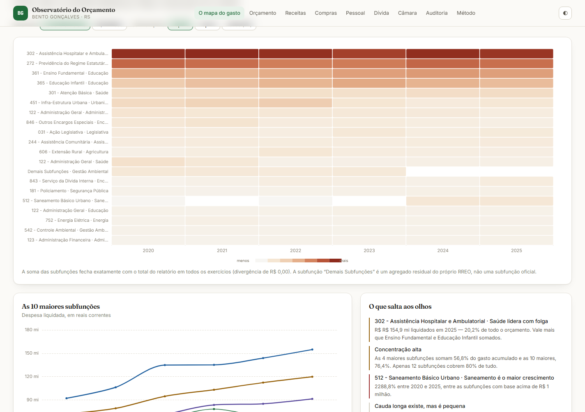

# Observatório do Orçamento — Bento Gonçalves/RS

Site de análise do orçamento público municipal: de onde vem o dinheiro, para
onde vai, quem recebe e o que isso significa para as contas públicas.

Todos os números são **calculados por código** a partir de dados oficiais.
Nenhum valor é digitado à mão, e o pipeline se recusa a publicar quando uma
âncora contábil não fecha.



---

## O que o site cobre

| Seção | Conteúdo |
|---|---|
| **O mapa do gasto** | Mapa de calor do peso de cada subfunção, ano a ano; séries das 10 maiores; ranking completo |
| **Orçamento e execução** | Funil dotação → empenhado → liquidado → pago, por função e por exercício |
| **Receitas** | Previsto × arrecadado, estrutura da arrecadação, fluxo mensal |
| **Compras e fornecedores** | Maiores fornecedores, licitações, contratos, ritmo do caixa |
| **Pessoal** | Quadro por vínculo, remuneração, limites da LRF, busca de servidores |
| **Dívida e equilíbrio** | Dívida consolidada líquida, restos a pagar, regra de ouro, RPPS |
| **Câmara** | O legislativo municipal em números |
| **Auditoria** | Validação por exercício, limitações conhecidas, cobertura |
| **Método** | Fontes, decisões de método, como reproduzir |

---

## Arquitetura

Duas partes independentes, unidas por um arquivo:

```
prefeitura/v2/
├── pipeline/              Python 3.11+ — sem dependências externas
│   ├── coleta_siconfi.py  baixa RREO, RGF e DCA do Tesouro Nacional
│   ├── coleta_bg.py       baixa o Portal de Transparência municipal
│   ├── classificacao.py   tabelas oficiais (Portaria MOG 42/1999)
│   ├── processa.py        decodifica os anexos e gera out/dados.json
│   ├── valida.py          25 âncoras de validação
│   ├── raw/               dados brutos (git-ignored, ~310 MB)
│   └── out/dados.json     o pacote que o site consome (~1,3 MB)
└── web/                   React 18 + Vite 6 + TypeScript 5 + Tailwind 3
    ├── public/dados.json  cópia servida estaticamente
    └── src/
        ├── secoes/        um componente por seção
        ├── componentes/   gráfico, blocos, cabeçalho, carregador
        ├── lib/           formato, cálculos, tema, acesso a dados
        └── tipos.ts       tipos do pacote de dados
```

O contrato entre as duas partes é o `dados.json`. O pipeline não sabe que
existe uma interface; o site não sabe de onde os números vieram.

---

## Como rodar

### 1. Coletar os dados

```bash
cd pipeline
python coleta_siconfi.py    # 133 requisições ao Tesouro
python coleta_bg.py         # 159 requisições ao portal municipal
```

Os coletores têm cache em disco e retomada: rodar de novo só busca o que falta.
Use `--forcar` para rebaixar tudo, ou `--so-relatorio` para ver o que já existe.

### 2. Processar e validar

```bash
python processa.py          # gera out/dados.json e copia para web/public/
python valida.py            # confere 25 âncoras
```

O processador escreve o pacote nas duas localizações. A validação compara os
números com âncoras conhecidas e com identidades contábeis.

### 3. Rodar o site

```bash
cd ../web
pnpm install
pnpm dev                    # http://localhost:5180
```

Build de produção:

```bash
pnpm build                  # gera dist/ (892 KB, 292 KB gzip)
pnpm preview                # serve o build
```

---

## Decisões de método

### Função e subfunção são reconstruídas por posição

O RREO-Anexo 02 **não traz códigos numéricos**. Traz nomes, na ordem do
relatório: a linha de uma função é seguida pelas linhas de suas subfunções.
O pipeline percorre os blocos nessa ordem e reconhece os nomes contra uma
tabela derivada da Portaria MOG 42/1999 e atualizações posteriores.

### A validação é uma âncora contábil

A soma das subfunções tem de fechar com o total declarado no relatório. Se não
fechasse, o pipeline levantaria erro em vez de publicar. Nos seis exercícios a
divergência é de **R$ 0,00**.

### O pago vem da DCA

O RREO-Anexo 02 não tem coluna de despesa paga. Os valores pagos por função e
subfunção vêm da DCA-Anexo I-E, casados por código.

### O percentual de pessoal é o oficial

O RGF já publica a Despesa Total com Pessoal como percentual da **RCL Ajustada**,
na coluna própria. Esse é o número usado — não uma divisão nossa.

### Valores ausentes não viram zero

Onde um dado não existe, o site mostra `—`. Exibir zero onde não há dado seria
afirmar algo falso sobre a execução orçamentária.

---

## Validação

`valida.py` confere 25 pontos, entre eles:

- Totais liquidados de cada exercício contra a referência do projeto anterior
- Acumulado do período (R$ 3.764.243.739,55)
- Âncora contábil: soma das subfunções = total, em todos os anos
- Concentração: subfunção 302 = 20,2% em 2025
- Funções dominantes: Saúde 28,8%, Educação 23,1%, Previdência 15,5%
- Coerência: zero casos de liquidado > empenhado, zero valores negativos
- Indicadores derivados: per capita e os limites da LRF

```
$ python valida.py
...
TODAS AS VERIFICAÇÕES PASSARAM (25)
```

---

## Limitações conhecidas

O site documenta as próprias limitações na seção **Auditoria**:

- **A API municipal não expõe a classificação programática por pagamento.**
  O campo vem nulo em todas as 309.904 ordens, então não é possível amarrar
  um pagamento a uma subfunção.
- **Natureza da despesa e subfunção não se cruzam.** O Anexo 02 classifica por
  função; o Anexo 01, por categoria econômica. Não há anexo público com os
  dois eixos.
- **Pisos de Saúde e Educação são aproximações**, não a apuração oficial do
  TCE ou do Ministério da Saúde.
- **Valores em reais correntes**, sem correção pela inflação.
- **Dívida ativa indisponível**: o endpoint do sistema tributário retorna erro
  de configuração na API do município.

---

## Acessibilidade e temas

- Navegação completa por teclado, com foco visível.
- Tema claro e escuro, seguindo a preferência do sistema e com alternância manual.
- Respeita `prefers-reduced-motion` e `prefers-contrast`.
- Cada gráfico tem `role="img"` e rótulo descritivo; as tabelas trazem os mesmos
  números para quem prefere ler.

---

## Licença

MIT.
